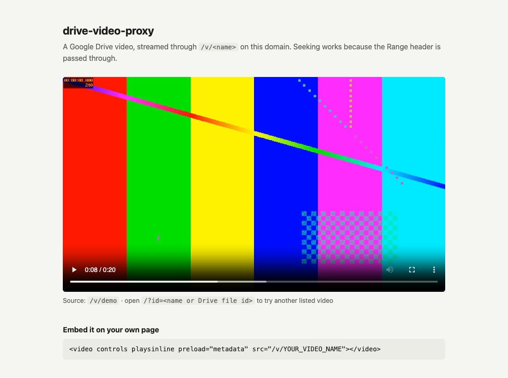
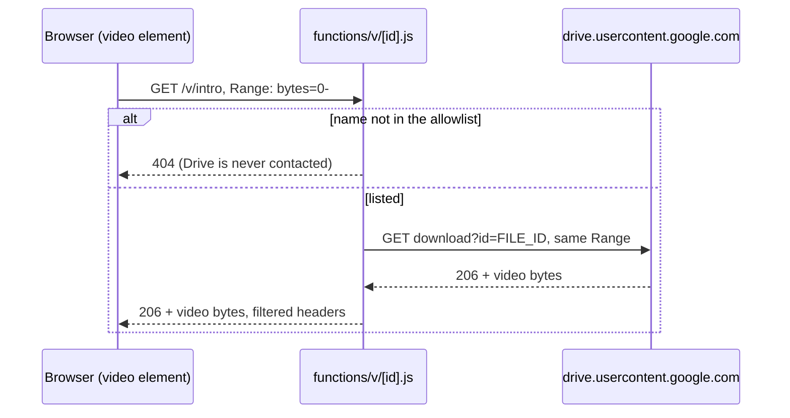

# drive-video-proxy

Play Google Drive videos in your own `<video>` element, from your own domain.

A single Cloudflare Pages Function (about 60 lines, no runtime dependencies) streams the file from Drive, passes the `Range` header through so seeking works, and serves only the Drive files you allowlist. The video stays in Drive, so there is no storage bill.

```html
<video controls playsinline preload="metadata" src="/v/intro"></video>
```



## Why

- Drive's embed player is an iframe with Drive's own controls and branding. You cannot style it, and on phones it can show two layers of controls.
- A `<video src>` pointing straight at Drive gets `403` when the request comes from another site. The same URL requested by a server works.
- This function is that server. It runs on the Cloudflare free plan.
- The allowlist keeps your domain from becoming an open proxy for any public Drive file.

## Quick start

Requirements: Node 22 or newer. Wrangler comes in as a dev dependency.

```sh
git clone https://github.com/onder007/drive-video-proxy.git
cd drive-video-proxy
npm install
```

Newer npm versions may warn that `workerd`'s install script was not run. You can ignore it: the dev server and the tests work without it.

1. In Drive, share the video as **Anyone with the link: Viewer**.
2. Copy its file id, the part of the share link between `/file/d/` and `/view`:
   `https://drive.google.com/file/d/<FILE ID>/view`
3. Put the id in `videos.json`, replacing the placeholder:
   ```json
   ["<FILE ID>"]
   ```
4. Start the local server:
   ```sh
   npm run dev
   ```
5. Open `http://localhost:8788/?id=<FILE ID>`. The video should play and seek.

Then use it on your own pages with `<video src="/v/<FILE ID>">`, or give it a short name (below).

## Short names instead of Drive ids

Write `videos.json` as an object to serve each video under a name of your choice:

```json
{
  "intro": "<FILE ID>",
  "product-tour": "<ANOTHER FILE ID>"
}
```

The video is then at `/v/intro`, and `/v/<FILE ID>` answers `404`. The Drive id stays out of your URLs and page source. It only shows up in the `Link` header of a `502`, where the page needs it to fall back to Drive's player.

## How it works



| Situation | Response |
|---|---|
| Listed video, Drive answers with a video | `200` or `206`, body streamed as it arrives |
| Name or id not in the allowlist | `404`, Drive is never contacted |
| Drive answers with an error, or with an HTML page instead of a video (download quota, virus-scan notice, file not shared) | `502` with `Link: <https://drive.google.com/file/d/<id>/preview>; rel="alternate"` |
| Drive unreachable | `502` |
| No response headers from Drive within 15 seconds | `504` |
| `HEAD` request | `405` |

Only `content-type`, `content-length`, `content-range`, `accept-ranges`, `etag` and `last-modified` are passed on. Drive's cookies, CSP and `content-disposition: attachment` are dropped, and `cache-control: public, max-age=3600` is added.

The example page in `public/index.html` catches the `<video>` error, reads the `Link` header and swaps in Drive's own player. Unlisted names get no `Link`, so `?id=` cannot be used to embed an arbitrary Drive file on your domain.

## Deploy to Cloudflare Pages

From Git: in the Cloudflare dashboard go to **Workers & Pages > Create > Pages > Connect to Git** and pick your fork. Framework preset: **None**, build command: empty, build output directory: **`public`**. Cloudflare picks up the `functions/` folder on its own.

From the command line:

```sh
npx wrangler login
npx wrangler pages project create drive-video-proxy --production-branch main
npx wrangler pages deploy public --project-name drive-video-proxy
```

`*.pages.dev` addresses are blocked in some countries, so attach a custom domain if your visitors may be there.

## Configuration

| Setting | Where | Default | Purpose |
|---|---|---|---|
| `videos.json` | file in the repo | one placeholder | Allowlisted Drive file ids (`["id", ...]`) or names (`{"name": "id"}`), deployed with the code. |
| `VIDEO_IDS` | environment variable | empty | More videos, separated by commas, spaces or new lines: `id` serves `/v/id`, `name=id` serves `/v/name`. Merged with `videos.json`; when both list the same name, `VIDEO_IDS` wins. Use it to keep ids out of the repository. |
| `CACHE_SECONDS` | environment variable | `3600` | `max-age` of the `cache-control` header sent to browsers. |
| `UPSTREAM_URL` | environment variable | Drive's download URL | Where to fetch from, with `{id}` replaced by the file id. The e2e test points it at a local fake Drive. Leave it unset in production. |

In production, set the variables in the Pages project's settings (Variables and Secrets). Locally, put them in a `.dev.vars` file next to `package.json` (it is git-ignored):

```
VIDEO_IDS=<FILE ID>,intro=<ANOTHER FILE ID>
CACHE_SECONDS=86400
```

## Limitations

- **Download quota.** Drive limits how often a single file can be downloaded. When a popular video hits the limit, Drive sends an HTML page instead of the video for a while. The function then answers `502` and the example page falls back to Drive's player. For high-traffic videos, use real video hosting.
- **No edge cache.** Every request goes through the function to Drive. `cache-control` only helps the visitor's browser, and each seek is a new request that counts toward your Cloudflare Workers request limits.
- **Not an official API.** `drive.usercontent.google.com/download?id=...&export=download&confirm=t` is not a documented Google endpoint. Google can change it without notice.
- **Public files only.** Files must be shared as "Anyone with the link". Private files would need the Drive API with OAuth, which is out of scope.
- **File size.** Tested with files up to about 50 MB. Multi-gigabyte files are untested.
- **GET only.** `HEAD` gets `405`, so tools that probe with `HEAD` before downloading will not work.

## Tests

```sh
npm test           # unit tests (node:test), no network needed
npm run test:e2e   # runs the function in `wrangler pages dev` against a local fake Drive
```

The unit tests cover the allowlist and names, header filtering, cache settings, `Range` forwarding, the `502`/`504` cases and the timeout, with a mocked `fetch`. The e2e test checks byte-exact `206` responses, the `404` for unknown ids, the `502` for an HTML answer and the `405` for `HEAD`.

## Project layout

```
functions/v/[id].js   the proxy (Cloudflare Pages Function)
videos.json           allowlist of Drive file ids
public/index.html     example page with <video> and the Drive fallback
test/proxy.test.js    unit tests
test/e2e.test.js      end-to-end test with wrangler pages dev
```

## License

[MIT](LICENSE)
